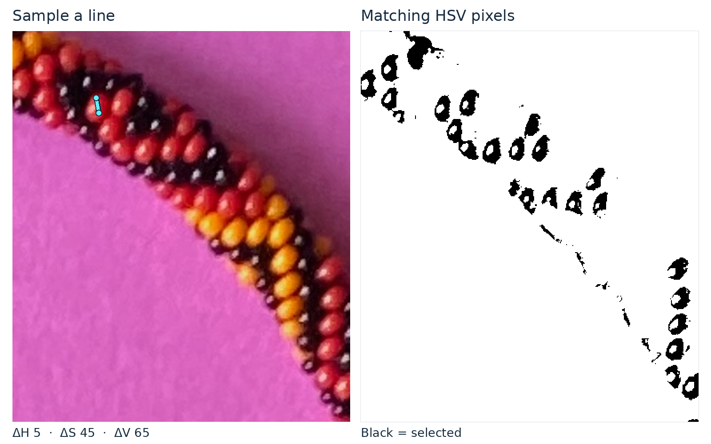
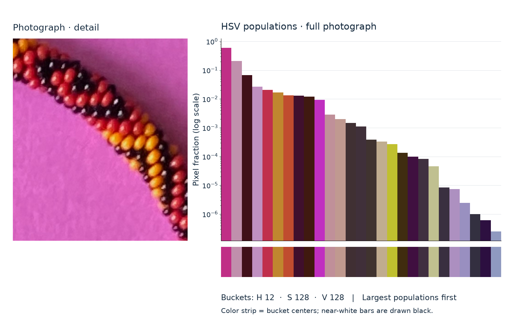

# HSV Tools

Two small OpenCV/Matplotlib tools for exploring image colors. They were developed while investigating the red, yellow, and black beads in a necklace photograph.



HSV Picker samples colors along a line and finds pixels with similar hue, saturation, and value. The illustration uses the actual picker calculation, with an annotated sampling line and identical crops of the photograph and mask. Selection follows pixel color; shadows and highlights can leave parts of a bead unselected.

## Install and run

Use maintained Python 3.14 (or a newer compatible version) with a desktop display for the interactive picker.

```bash
python3 -m venv .venv
source .venv/bin/activate
python -m pip install -r requirements.txt
python hsv_picker.py docs/figures/source/beads-photo-2.jpg
```

On Windows, activate with `.venv\Scripts\activate`.

## HSV Picker

Set the **ΔH / ΔS / ΔV** sliders, then left-click two endpoints on the left image. The line's HSV samples determine the selection throughout the image; the right panel shows **black for selected pixels** and white elsewhere. After changing tolerances, click two endpoints again to recalculate.

| Control | Action |
| --- | --- |
| Two left clicks | Sample a line and replace the mask |
| `+` or `=` / `-` | Zoom in / out around the mouse |
| `m` | Merge subsequent selections into the current mask |
| `r` | Disable merging; keep the current mask |
| `s` | Save the full-resolution mask; enter a filename suffix in the terminal |
| `q` or Escape | Quit |

Saved masks use the input filename and extension, with the supplied suffix, in the current directory. HSV uses OpenCV's scale: H = 0–179 with circular wraparound, S/V = 0–255.

## HSV Counts

HSV Counts groups pixels into HSV buckets and plots their populations, coloring each bar by its bucket center. The vertical axis is pixel fraction on a logarithmic scale. By default, hue groups are ordered by population; `--by_bucket` orders individual buckets by population.

```bash
python hsv_counts.py docs/figures/source/beads-photo-2.jpg \
  --hue-bucket-size 12 --sat-bucket-size 128 --val-bucket-size 128 --by_bucket
```



The example counts the **full photograph**, including its pink background; only the photograph panel is cropped for display. Coarse buckets keep the chart readable. The color strip shows bucket centers; near-white bars are drawn black by the program.

## Reproduce the illustrations

```bash
python scripts/generate_hsv_figures.py
python -m unittest discover -s tests -v
```

Generation runs without a desktop or network connection. It reuses `hsv_picker.mask_from_line` and captures the actual `hsv_counts.py` plot. The unchanged source photograph is committed under `docs/figures/source/`.

[Provenance, coordinates, tolerances, and display methods](docs/figures.md) · [Candidate comparison](docs/figures/hsv-tools-candidates.png) · [400-pixel preview](docs/figures/hsv-tools-card-preview.png)
